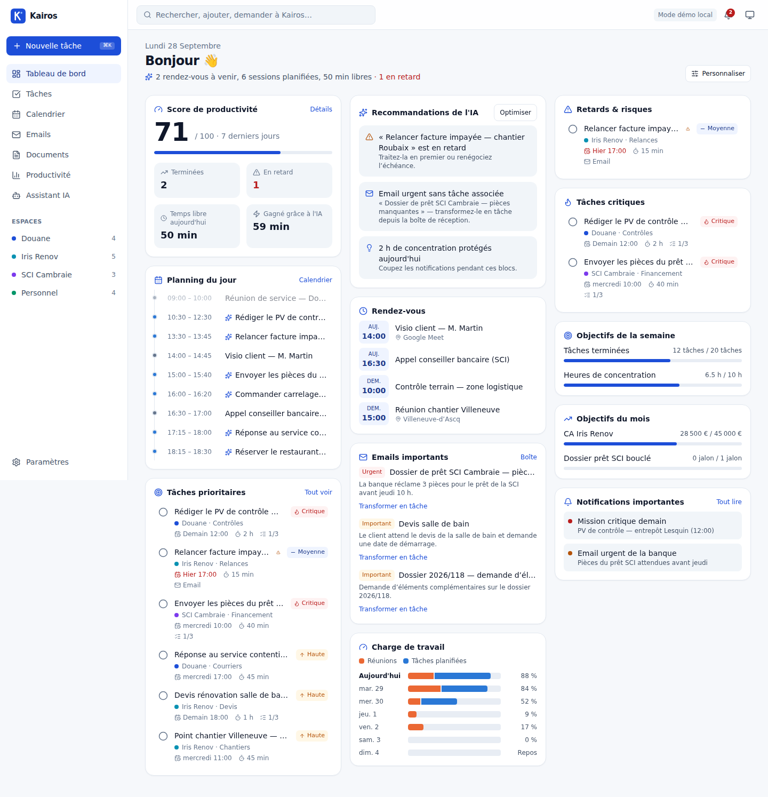

# Kairos — assistant exécutif personnel intelligent

Kairos centralise **tâches, agenda, emails, documents et objectifs** des quatre domaines d'activité (Douane · Iris Renov · SCI Cambraie · Personnel) et laisse une IA **planifier, prioriser, trier et rappeler** en autonomie — le meilleur de Motion, ClickUp, Notion, Todoist et Reclaim.ai dans une seule application.

**iPhone · Android · Windows · Mac · Web** — un seul moteur métier partagé, fonctionnement hors ligne.



## Ce qui fonctionne dès maintenant

- **Planification automatique** : placement des tâches autour des réunions, découpage, plafond de charge quotidienne, temps de concentration protégé, détection des tâches à risque, replanification continue.
- **Priorités dynamiques** : score = priorité × urgence réelle (marge avant échéance) × poids de la catégorie.
- **Saisie en langage naturel et commandes vocales en français** : « Appeler la banque vendredi 10h30 #sci !urgent 30min », « Prépare mon planning de demain »…
- **Google Calendar** bidirectionnel, **Gmail** trié par l'IA (importance, résumé, actions, échéances → tâches, brouillons), **Google Drive** (classement automatique).
- **Multi-IA** : Claude, Claude Code, Skywork AI, Microsoft Copilot — choix du moteur par type de tâche, avec repli.
- **Rappels WhatsApp** la veille et 1 h avant, renforcés automatiquement pour les missions critiques.
- **Documents** PDF/DOCX : devis, factures, comptes-rendus, rapports, courriers, checklists, synthèses.
- **Tableau de bord** personnalisable et **indicateurs de productivité** (dont le temps gagné grâce à l'IA).
- **Mode clair/sombre**, PWA installable, **hors ligne** avec synchronisation automatique.

## Démarrer

```bash
corepack enable && pnpm install
pnpm --filter @kairos/core build
pnpm --filter @kairos/web dev          # → http://localhost:3000 (mode démo, sans backend)
```

Pile complète (PostgreSQL, API, Google, IA, WhatsApp) : voir la [documentation technique](docs/15-documentation-technique.md).

## Monorepo

| Paquet | Rôle |
|---|---|
| [`packages/core`](packages/core) | Moteur métier partagé et testé : planification, scoring, NLP, rappels, métriques, routage IA |
| [`apps/api`](apps/api) | API NestJS + Prisma/PostgreSQL : intégrations Google, WhatsApp, IA, jobs autonomes |
| [`apps/web`](apps/web) | Next.js 15 — web, PWA et base du desktop |
| [`apps/mobile`](apps/mobile) | Expo / React Native — iPhone et Android |
| [`apps/desktop`](apps/desktop) | Tauri 2 — Windows et macOS |

## Documentation

Les 18 livrables (architecture, cahier des charges, base de données, design system, parcours, wireframes, maquettes, API, roadmaps MVP/V2/V3, déploiement, sécurité, doc technique) : **[docs/](docs/README.md)**.
