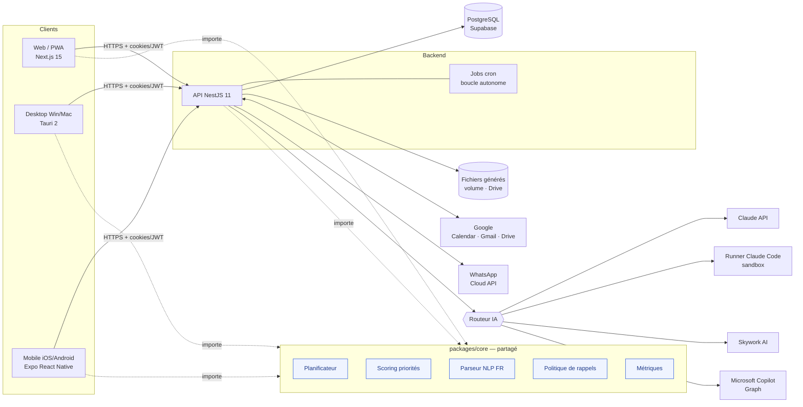
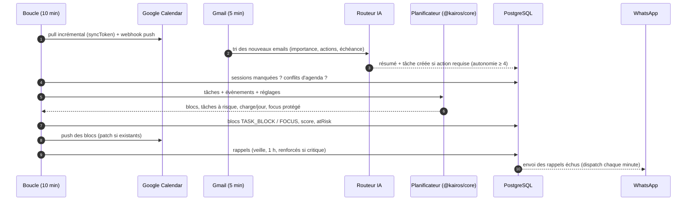
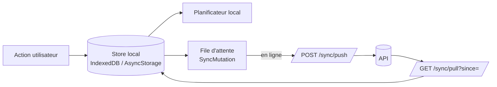

# 1. Architecture complète du projet

> **Kairos** — assistant exécutif personnel intelligent. Un seul utilisateur, cinq plateformes (iPhone, Android, Windows, Mac, Web), un seul moteur métier partagé.

## 1.1 Principes directeurs

| Principe | Traduction concrète |
|---|---|
| **Un moteur, cinq écrans** | Toute la logique métier (planification, scoring, rappels, NLP, métriques) vit dans `packages/core`, TypeScript pur, sans dépendance à un framework. Elle tourne à l'identique sur le serveur, dans le navigateur, sur mobile et hors ligne. |
| **Local-first** | Chaque client garde une copie de travail (IndexedDB / AsyncStorage). L'interface ne bloque jamais sur le réseau ; une file d'attente rejoue les modifications à la reconnexion. |
| **Autonomie de niveau 5, mais réversible** | L'IA agit seule (planifie, crée des tâches depuis les emails, génère des documents) puis rend compte. Chaque action est journalisée (`AutomationLog`) avec de quoi l'annuler. Jamais d'envoi d'email ni de suppression sans validation. |
| **IA interchangeable** | L'application ne dépend d'aucun fournisseur : un routeur choisit le moteur (Claude, Claude Code, Skywork, Copilot) par capacité, avec repli automatique. |
| **Sécurité par défaut** | Mono-propriétaire (allowlist d'un email Google), jetons OAuth chiffrés AES-256-GCM, sessions à rotation, webhooks signés, portées Google minimales. |

## 1.2 Vue d'ensemble (C4 — niveau conteneurs)



## 1.3 Choix technologiques et justification

| Couche | Choix | Pourquoi (et alternatives écartées) |
|---|---|---|
| Web | **Next.js 15 (App Router) + React 19 + TypeScript + Tailwind CSS 4** | Recommandé dans le brief ; PWA installable, export statique possible pour le desktop. |
| Mobile | **Expo (React Native 0.81)** | Préféré à Flutter : même langage (TypeScript) et **même moteur `@kairos/core`** que le web et l'API → zéro duplication de la logique de planification. Build cloud EAS pour iOS sans Mac. |
| Desktop | **Tauri 2** | Enveloppe native de l'app web (~10 Mo contre ~150 Mo pour Electron), notifications système, un seul code UI. |
| Backend | **Node.js 22 + NestJS 11** | Modules, injection de dépendances, cron (`@nestjs/schedule`), garde globale d'authentification. |
| Base | **PostgreSQL 16 via Supabase** + **Prisma 6** | Relationnel (tâches ↔ catégories ↔ évènements), JSON pour les réglages, RLS disponible, sauvegardes PITR gérées. |
| Auth | **Google OAuth 2.0** (une seule connexion → Calendar, Gmail, Drive) | Un seul consentement ; allowlist `OWNER_EMAIL`. Sessions JWT 15 min + refresh token rotatif 30 j (cookie httpOnly). |
| IA | **Routeur multi-fournisseurs** | Claude par défaut (rédaction, tri, planification), Copilot (documents Microsoft), Skywork (automatisations), Claude Code (scripts), configurable par l'utilisateur. |
| Notifications | **WhatsApp Business Cloud API** | Modèle `kairos_reminder` approuvé par Meta ; réponses « FAIT / REPORTER » traitées par webhook signé. |
| Monorepo | **pnpm workspaces + Turborepo** | Cache de build, un seul `pnpm install`, versions cohérentes. |

## 1.4 Découpage en paquets

```
kairos/
├─ packages/core    ← domaine pur : types, schémas Zod, planificateur, scoring, NLP, rappels, métriques, routage IA
├─ apps/api         ← NestJS : REST, intégrations Google/WhatsApp/IA, jobs, Prisma
├─ apps/web         ← Next.js : UI complète, store local-first, PWA, voix
├─ apps/mobile      ← Expo : écran « Aujourd'hui », saisie rapide, hors ligne
├─ apps/desktop     ← Tauri : enveloppe native Windows/macOS du web
└─ infra            ← SQL Supabase (RLS), scripts d'exploitation
```

## 1.5 La boucle autonome (le « cerveau »)



Déclencheurs de replanification : création/modification de tâche (anti-rebond 3 s), nouvel évènement, webhook Google Calendar, boucle périodique, commande vocale (« Prépare mon planning »), changement des réglages.

## 1.6 Algorithme de planification (résumé)

Implémenté dans `packages/core/src/scheduler.ts`, fonction **pure et déterministe** (testée) :

1. **Fenêtres de travail** sur l'horizon (14 j par défaut) à partir des heures de travail, dans le fuseau de l'utilisateur (changements d'heure gérés).
2. **Créneaux libres** = fenêtres − réunions − tampons (10 min), arrondis au quart d'heure.
3. **Classement** des tâches par score dynamique : priorité déclarée + urgence (marge entre temps restant et travail restant) + ancienneté, × poids de la catégorie.
4. **Placement glouton au plus tôt**, découpage autorisé (sessions ≥ 30–45 min), plafond de charge quotidienne, préférence pour les longs créneaux pour le travail profond, respect de `startAfter`.
5. **Détection du risque** : tâche finissant après l'échéance ou capacité insuffisante → `atRisk` (+ rappels renforcés, recommandation IA).
6. **Protection du temps de concentration** (façon Reclaim) dans les créneaux restants.

## 1.7 Flux de données hors ligne



Idempotence par `clientMutationId`, verrouillage optimiste par `version` : en cas de conflit, la version serveur est renvoyée et remplace la locale.
