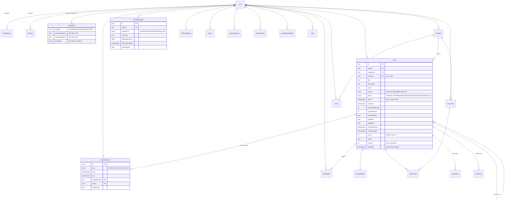

# 3. Schéma de base de données

Source de vérité : [`apps/api/prisma/schema.prisma`](../apps/api/prisma/schema.prisma) ; migration initiale : `apps/api/prisma/migrations/*_init`. PostgreSQL 16 (Supabase en production).

Chaque table métier porte `userId` : isolation (RLS en V2 — [`infra/supabase-rls.sql`](../infra/supabase-rls.sql)), export RGPD par utilisateur, et ouverture multi-comptes possible sans migration.

## 3.1 Diagramme entité-relation



## 3.2 Dictionnaire des tables

| Table | Rôle | Points clés |
|---|---|---|
| `User` | Propriétaire | `email` unique = `OWNER_EMAIL`, fuseau, téléphone WhatsApp. |
| `UserSettings` | Réglages | Heures de travail (JSON `WorkingHours`), concentration/jour, tampon, plafond, horizon, **niveau d'autonomie**, rappels, heures calmes, thème. |
| `Session` | Sessions | Hash SHA-256 du refresh token (jamais le jeton), rotation, révocation en cascade si réutilisation. |
| `Integration` | Comptes connectés | Jetons **chiffrés**, portées accordées, curseurs de synchro incrémentale. |
| `Category` | Espaces | `slug` stable (`douane`, `iris-renov`…), couleur, poids de scoring, sous-catégories, dossier Drive. |
| `Task` | Tâches | Cf. diagramme. Index `(userId,status,dueAt)`, `(userId,scheduledStart)`, `(userId,updatedAt)` pour la synchro. |
| `ChecklistItem` | Checklist | Ordonnée, échéance individuelle. |
| `Attachment` | Pièces jointes | Chemin de stockage ou `driveFileId`. |
| `TaskEvent` | Historique | Immuable (append-only) : acteur, action, diff. |
| `TimeEntry` | Temps réel | Chronomètre → `actualMinutes`, base du « temps réellement utilisé ». |
| `Note` | Notes façon Notion | Contenu bloc JSON, rattachable à une catégorie/tâche. |
| `CalendarEvent` | Agenda unifié | Évènements Google (`EVENT`) + blocs Kairos (`TASK_BLOCK`, `FOCUS`). `(userId, googleEventId)` unique. |
| `EmailMessage` | Emails triés | Métadonnées + analyse IA ; le corps n'est **pas stocké** (relu à la demande). |
| `Document` | Documents générés | Type, format, données structurées, `textContent` pour la recherche, lien Drive. |
| `Goal` | Objectifs | Période (semaine, mois, trimestre, année), cible, valeur courante, unité. |
| `DashboardWidget` | Personnalisation | Ordre, visibilité, taille. |
| `Notification` | Rappels | Canal, `sendAt`, statut, tentatives. Index `(status, sendAt)` pour l'envoi. |
| `AiRoutingRule` | Routage IA | Capacité → moteur + replis. |
| `AiRun` | Journal IA | Moteur, modèle, jetons, latence, erreur (coûts). |
| `AutomationLog` | Actions autonomes | Résumé lisible + `undoPayload` pour annuler. Base du « temps gagné ». |
| `SyncMutation` | Idempotence hors ligne | `clientMutationId` = PK ; statut APPLIED/CONFLICT/REJECTED. |

## 3.3 Règles de gestion en base

- **Suppression logique** des tâches et évènements (`deletedAt`) : nécessaire pour propager les suppressions aux clients hors ligne (`/sync/pull`).
- **Verrouillage optimiste** : `Task.version` incrémentée à chaque écriture ; une mutation hors ligne avec une `baseVersion` obsolète renvoie un conflit.
- **Horodatages en UTC** (`timestamptz`) ; conversion au fuseau de l'utilisateur uniquement dans le moteur et l'UI.
- **Rétention** (job de purge prévu en V2) : `AiRun` 90 j, `EmailMessage` archivés 180 j, `TaskEvent` et `AutomationLog` conservés (audit).

## 3.4 Commandes

```bash
pnpm db:up          # PostgreSQL + Redis locaux (Docker)
pnpm db:migrate     # prisma migrate dev
pnpm db:seed        # données de démonstration réalistes
pnpm --filter @kairos/api exec prisma studio   # explorateur visuel
```
