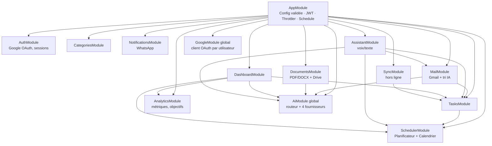
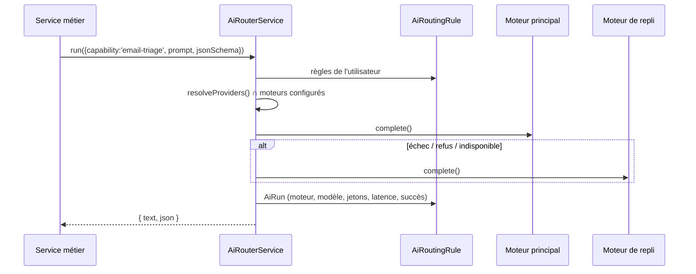

# 5. Architecture Backend

API **NestJS 11** (Node 22), préfixe `/api`, Prisma 6 / PostgreSQL. Code : `apps/api/src`.

## 5.1 Modules

| Module | Responsabilités | Fichiers |
|---|---|---|
| `common` | Prisma, chiffrement AES-GCM, garde JWT globale + `@Public()`, `@CurrentUser()`, pipe Zod, mappeurs Prisma → domaine | `common/*` |
| `config` | Validation Zod des variables d'environnement au démarrage (échec immédiat si invalide) | `config/env.ts` |
| `auth` | Consentement Google (une fois pour Calendar/Gmail/Drive), vérification `OWNER_EMAIL`, sessions (JWT 15 min + refresh rotatif), amorçage (catégories, réglages, routage IA), `dev-login` en développement | `modules/auth` |
| `google` | Client OAuth2 par utilisateur, rafraîchissement et persistance chiffrée des jetons, curseurs de synchro | `modules/google` |
| `tasks` | CRUD, saisie rapide NLP, sous-tâches, checklist, historique, priorités (scoring) | `modules/tasks` |
| `scheduler` + `calendar` | Replanification (anti-rebond), boucle autonome, application des blocs, synchro Google Calendar, webhook, créneaux libres | `modules/scheduler`, `modules/calendar` |
| `mail` | Import Gmail (5 min), tri IA, email → tâche, brouillons Gmail, synthèse | `modules/mail` |
| `notifications` | Calcul des rappels (30 min), envoi (chaque minute, 3 tentatives), webhook WhatsApp signé (FAIT / REPORTER) | `modules/notifications` |
| `documents` + `drive` | Modèles (devis/facture calculés, checklist), rédaction IA, rendu PDF (pdfkit) / DOCX (docx), classement Drive, recherche | `modules/documents`, `modules/drive` |
| `ai` | Interface `AiProvider`, fournisseurs Claude / Claude Code / Skywork / Copilot, `AiRouterService`, cas d'usage `AiTasksService` | `modules/ai` |
| `assistant` | Intention locale → repli LLM → exécution → réponse parlée | `modules/assistant` |
| `analytics`, `dashboard` | Métriques (`computeMetrics`), séries hebdo, objectifs, agrégat d'accueil, recommandations IA, disposition des widgets | `modules/analytics`, `modules/dashboard` |
| `sync` | `push` idempotent (conflits), `pull` par curseur | `modules/sync` |

## 5.2 Tâches planifiées

| Job | Fréquence | Rôle |
|---|---|---|
| `SchedulerService.autonomousLoop` | 10 min | Pull agenda, sessions manquées → historique + journal, conflits → notification, replanification |
| `MailService.poll` | 5 min | Import + tri des nouveaux emails |
| `NotificationsService.planAll` | 30 min | (Re)calcul idempotent des rappels à 8 jours |
| `NotificationsService.dispatch` | 1 min | Envoi des rappels échus, reprise exponentielle |

> Production multi-instance : passer ces jobs sur **BullMQ + Redis** (déjà présent dans `docker-compose.yml`) avec verrou distribué — prévu en V2. En mono-instance (usage personnel), `@nestjs/schedule` suffit.

## 5.3 Routage IA

- **Claude** : SDK officiel `@anthropic-ai/sdk`, modèle `ANTHROPIC_MODEL` (défaut `claude-opus-5`), sorties structurées (`output_config.format` JSON Schema) pour le tri et l'extraction, gestion des arrêts `refusal` / `max_tokens`, effort bas pour les tâches simples.
- **Claude Code** : jamais dans le processus API ; appel HTTP d'un *runner* isolé (Claude Agent SDK en conteneur sandbox) — contrat `POST /run { prompt, system } → { output }`.
- **Skywork AI** et **Microsoft Copilot** : adaptateurs HTTP paramétrables (URL, modèle) — à valider selon les offres API souscrites.
- Ajouter un moteur = implémenter `AiProvider` + l'enregistrer dans `ai.module.ts`.

## 5.4 Gestion des erreurs & robustesse

- Validation systématique des entrées (schémas Zod partagés avec le front).
- Erreurs d'intégration isolées : un échec Google/IA n'interrompt ni la boucle ni les autres utilisateurs (journalisé).
- Google Calendar : `410 Gone` sur `syncToken` → resynchronisation complète automatique.
- Envoi WhatsApp : 3 tentatives, puis statut `FAILED` visible.
- Replanification protégée contre la concurrence (verrou par utilisateur + nouvelle demande différée).

## 5.5 Tests

- `packages/core` : 27 tests (planificateur, fuseaux/DST, scoring, rappels, NLP, métriques, routage IA).
- `apps/api` : chiffrement (intégrité GCM), rendu devis/factures (totaux, TVA), génération PDF/DOCX valides.
- Vérifié de bout en bout sur PostgreSQL 16 : migration, seed, saisie rapide, priorités, replanification, tableau de bord, assistant, document PDF, synchro hors ligne, 401 sans jeton.
