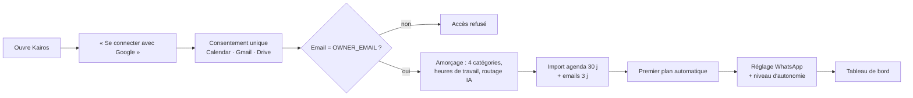
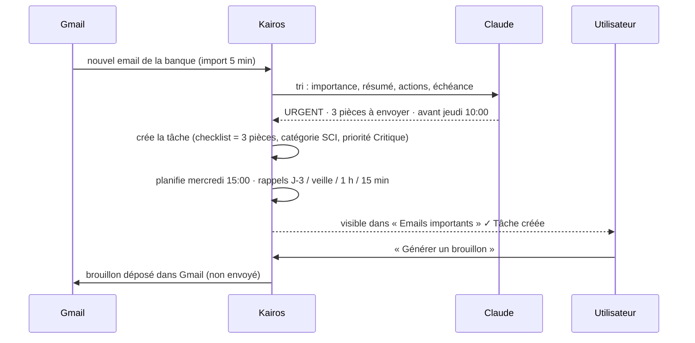

# 7. Parcours utilisateur

## P1 — Premier lancement (≈ 3 minutes)

## P2 — La matinée type (07:00 → 09:00)

1. **07:00** — WhatsApp : « 🔴 Aujourd'hui 12:00 : Rédiger le PV de contrôle » (mission critique).
2. **08:15** — Ouverture de l'app : tableau de bord → *2 rendez-vous, 6 sessions planifiées, 50 min libres, 1 en retard*.
3. Recommandation IA : « Relancer facture impayée est en retard — traitez-la en premier ».
4. Coche la relance (15 min) → le planning se recalcule, le temps libre augmente.
5. Ouvre le planning du jour : la rédaction du PV est placée **10:30–12:30** dans un créneau de concentration, entre deux réunions.

## P3 — Email → tâche (sans intervention, autonomie 5)

## P4 — Commande vocale en voiture (mobile)

« **Ajoute une réunion demain à 14h avec le notaire.** » → intention *CREATE_EVENT*, date J+1 14:00, 60 min → évènement créé dans Google Calendar → tâches replanifiées autour → réponse parlée : « C'est noté : Réunion avec le notaire mardi 29 septembre à 14:00. »

## P5 — Travail hors ligne (train, zone blanche)

1. Indicateur *Hors ligne*. Toutes les tâches, l'agenda et les documents récents restent consultables.
2. Création de 3 tâches, 2 terminées → *Hors ligne · 5 en attente*. Le planning est recalculé **localement**.
3. Retour du réseau → synchronisation automatique ; si une tâche a été modifiée ailleurs entre-temps, la version serveur l'emporte et l'écran se met à jour.

## P6 — Mission critique qui dérape

1. La tâche « Envoyer les pièces du prêt » (Critique, échéance mercredi 10:00) ne tient plus : réunions ajoutées mardi.
2. Le planificateur la marque **à risque** (minutes manquantes).
3. Actions automatiques : alerte ⚠ sur la tâche, recommandation IA, rappels renforcés (J-3, matin, 15 min), notification in-app.
4. L'utilisateur accepte « Optimiser » : les tâches basses priorités glissent à jeudi.

## P7 — Revue hebdomadaire (vendredi 17:00)

Productivité → taux de ponctualité, tâches créées vs terminées (8 semaines), temps planifié vs réel, **temps gagné grâce à l'IA**, objectifs atteints ; journal des automatisations (annulables). Ajustement des objectifs de la semaine suivante.

## P8 — Générer un devis (Iris Renov)

Documents → *Devis* → client, lignes (désignation, quantité, unité, PU HT, TVA — champ `data.lines` de l’API ; formulaire de saisie des lignes en V2) → PDF → calcul des totaux HT/TVA/TTC + mentions → rangé dans `Drive / Kairos / Iris Renov / 2026 / QUOTE` → lien dans la tâche « Devis salle de bain ».
