# 9. Maquettes UI

Captures **de l'application réelle** (`apps/web`, mode démo), générées automatiquement avec Playwright (1440 × 900, horloge figée au lundi 28 septembre 2026 à 10:20, fuseau Europe/Paris). Elles se régénèrent à l'identique après chaque évolution de l'UI.

## Tableau de bord — mode clair
Score de productivité, recommandations de l'IA, planning du jour (réunions ✦ blocs de tâches placés par l'IA), priorités, rendez-vous, emails importants, charge de travail par jour, objectifs, notifications.

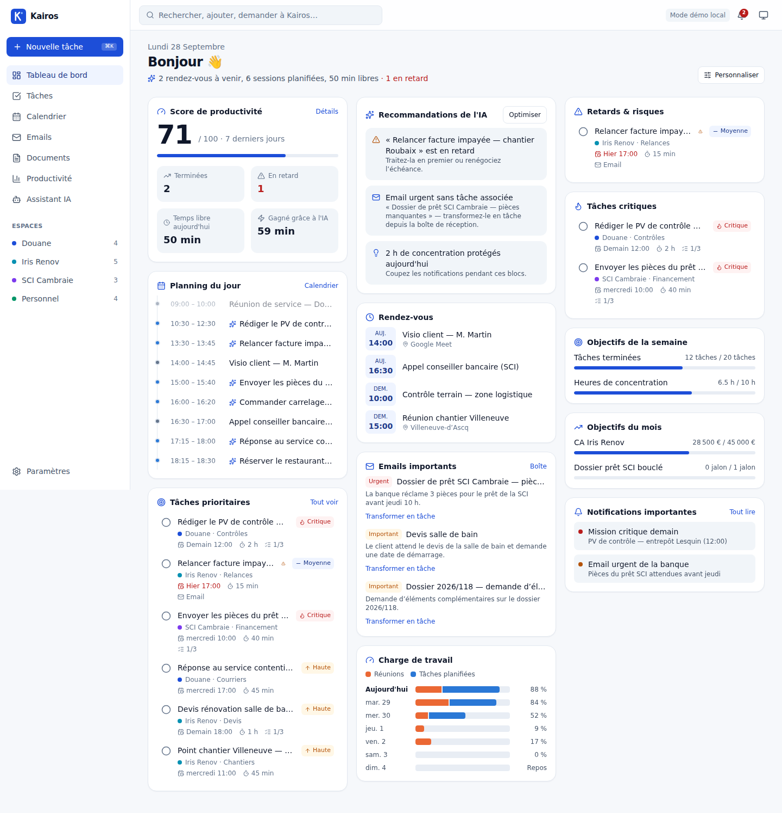

## Tableau de bord — mode sombre
Même écran : les couleurs sombres sont des valeurs choisies (et non une inversion).

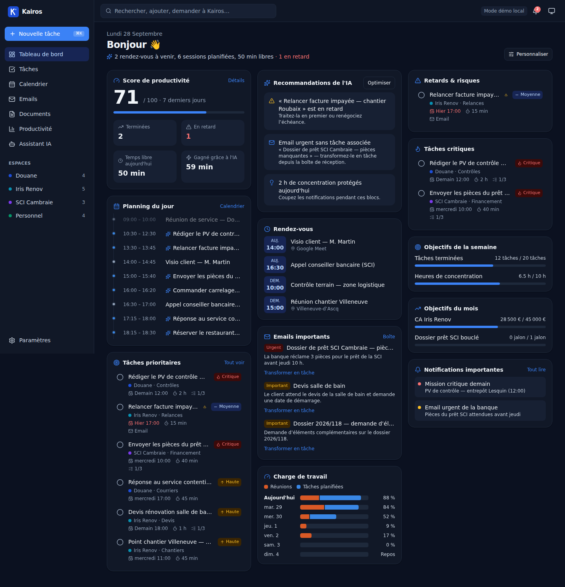

## Tâches — liste
Groupées par statut, triées par score dynamique ; catégorie, échéance (rouge si retard), durée, checklist, origine email, priorité.

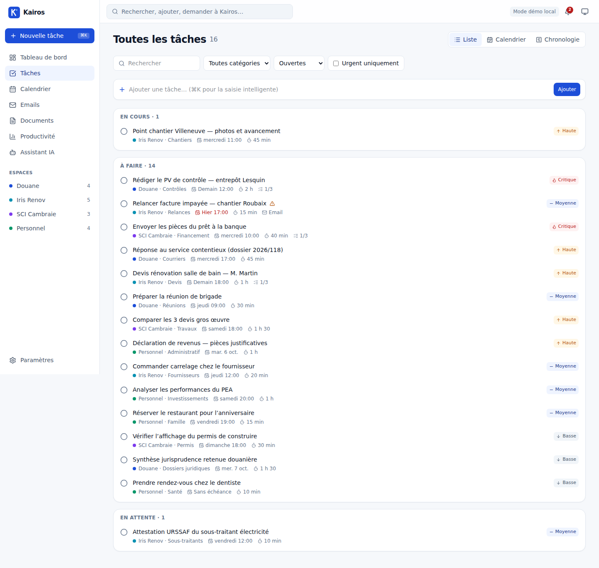

## Tâches — chronologie
Gantt 14 jours : de la session planifiée par l'IA jusqu'à l'échéance (trait rouge si la planification dépasse).

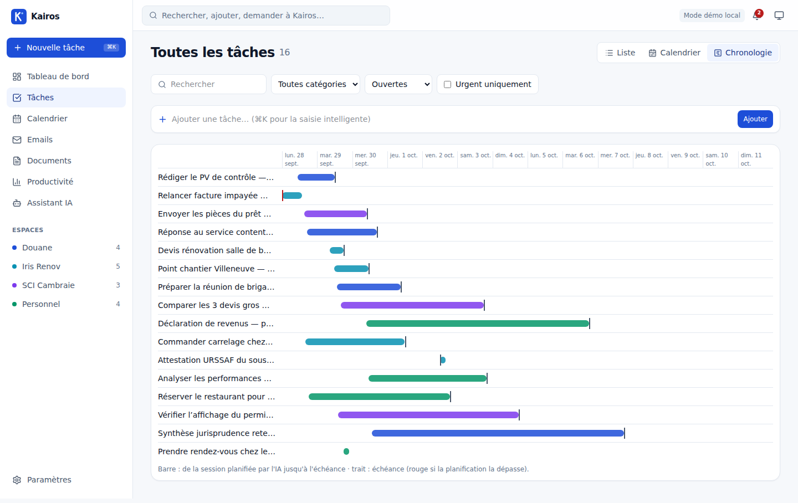

## Détail d'une tâche
Tous les champs du cahier des charges, checklist, sous-tâches avec échéances, pièces jointes, historique.

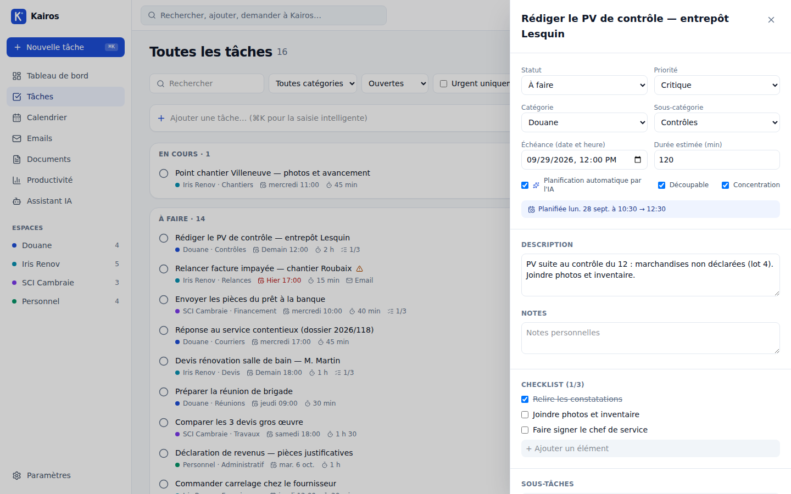

## Calendrier — semaine
Rendez-vous Google (gris), sessions de tâches placées par l'IA (bleu), concentration protégée (vert), ligne « maintenant », créneaux libres, plan de l'IA.

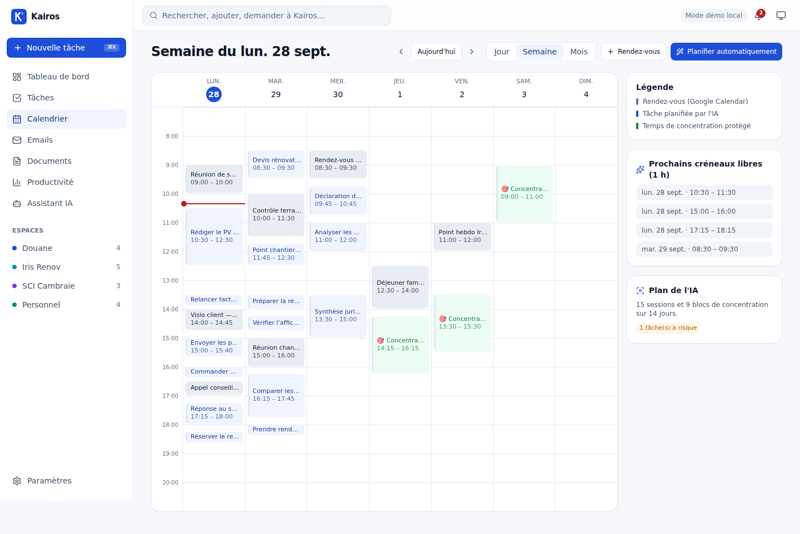

## Emails
Tri par importance, résumé IA, actions demandées, échéance détectée, « Transformer en tâche », « Générer un brouillon ».

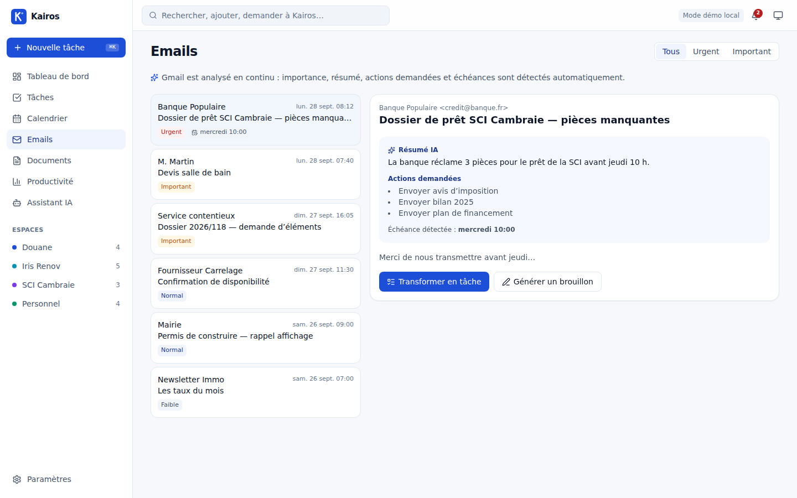

## Productivité
Indicateurs avancés, tâches créées vs terminées sur 8 semaines, répartition par espace, journal des automatisations.

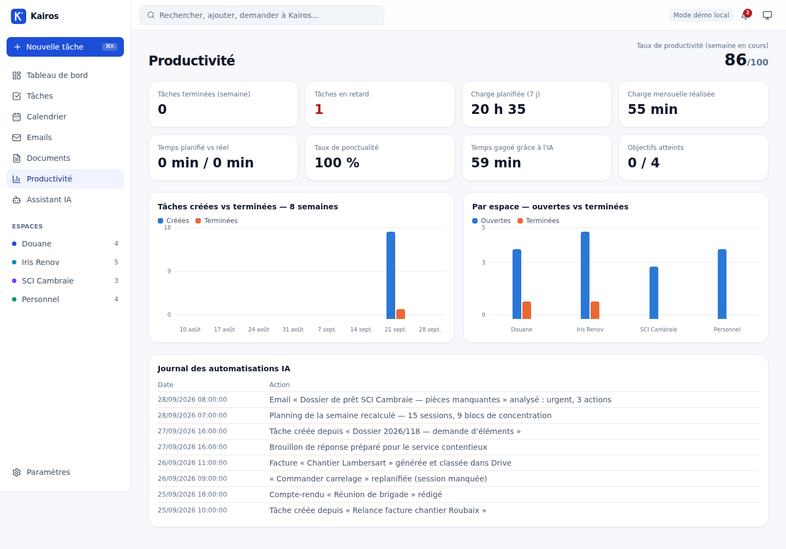

## Assistant IA (chat + voix)

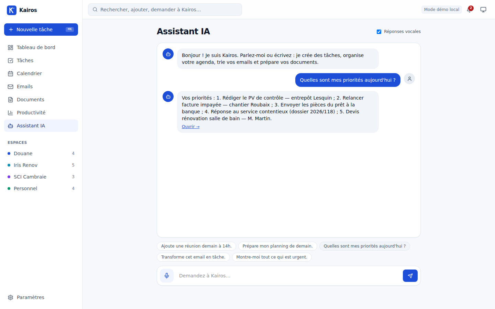

## Barre de commande ⌘K — saisie intelligente
Aperçu en direct de l'analyse : intention, titre, date, durée, priorité, catégorie.

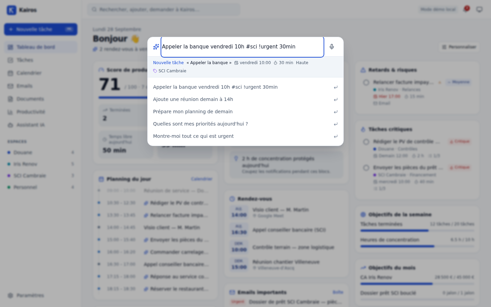

## Paramètres
Intégrations, planification (autonomie 1–5, heures de travail, concentration, tampons), routage des moteurs IA, WhatsApp, catégories personnalisées.

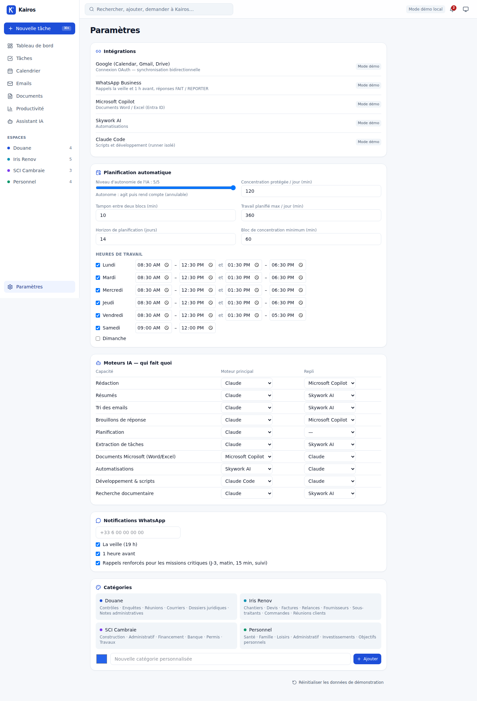

## Mobile (390 px)

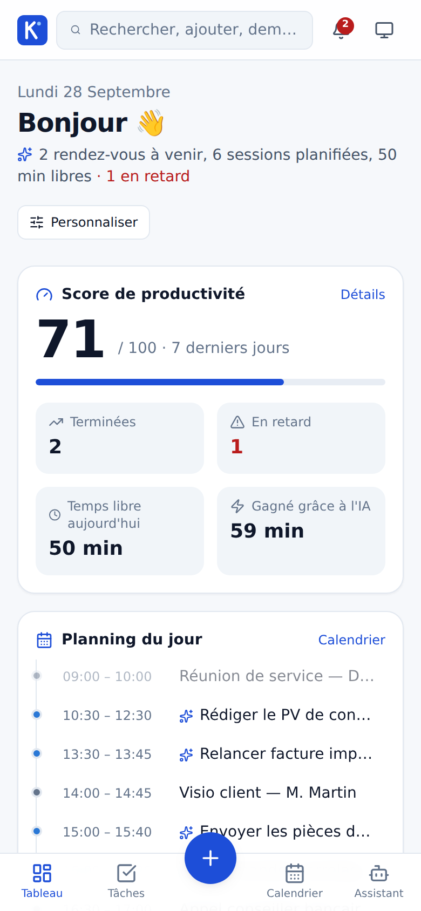

---

Régénérer : lancer `pnpm --filter @kairos/web build && pnpm --filter @kairos/web start`, puis le script Playwright décrit dans [15-documentation-technique.md](15-documentation-technique.md#captures-décran).
