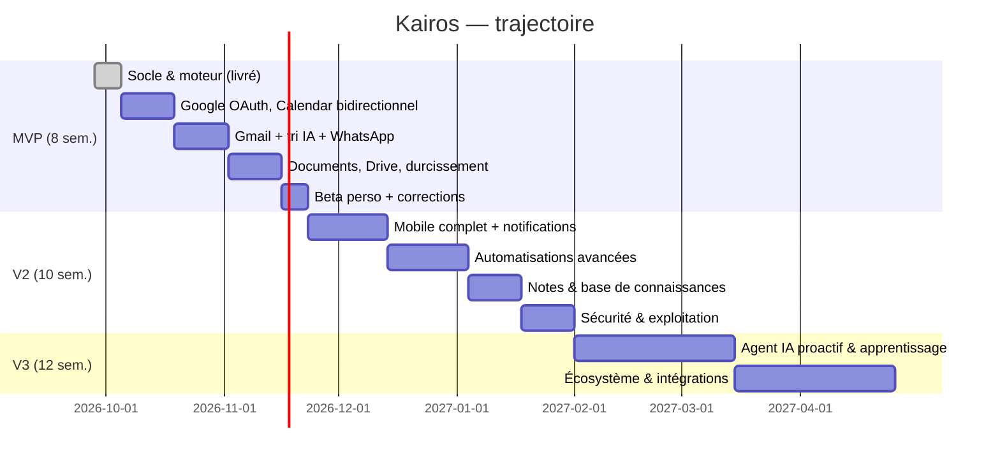

# 12–14. Roadmaps MVP, V2, V3

Hypothèse : un développeur full stack à temps plein (ou équivalent), itérations de 2 semaines, mise en production dès la fin du MVP pour un usage quotidien réel.

## 12. Roadmap MVP — « Mon assistant au quotidien » (≈ 8 semaines)

**Déjà livré dans ce dépôt (démarrage immédiat)**
- ✅ Monorepo, moteur partagé testé (planification, scoring, rappels, NLP français, métriques, routage IA).
- ✅ API NestJS complète : auth Google mono-propriétaire, tâches/catégories/checklist/sous-tâches/historique, planificateur autonome, synchro Google Calendar, Gmail + tri IA + email → tâche + brouillons, WhatsApp (envoi + réponses), documents PDF/DOCX + Drive, assistant, tableau de bord, analytique, synchro hors ligne. Migration Prisma initiale + seed.
- ✅ Web/PWA : 8 écrans, mode clair/sombre, ⌘K, voix, local-first IndexedDB, service worker.
- ✅ Mobile (écran Aujourd'hui) et desktop (enveloppe Tauri) amorcés.

**Reste à faire pour le MVP**
| Sprint | Contenu | Critère de sortie |
|---|---|---|
| 1 | Projet Google Cloud (écran de consentement, vérification des portées sensibles Gmail), déploiement Supabase + API + web | Connexion Google réelle en production |
| 2 | Recette Calendar bidirectionnel sur agenda réel (évènements récurrents, fuseaux, déplacements manuels), activation du webhook | 1 semaine d'usage sans conflit |
| 3 | Gmail : ajustement des prompts de tri sur vrais emails (Douane/Iris/SCI), seuils d'autonomie ; modèle WhatsApp approuvé par Meta | ≥ 80 % de tri jugé correct |
| 4 | Front connecté à l'API partout (brouillons, documents, objectifs éditables), formulaire de lignes de devis, pièces jointes (upload) | Parcours P1–P8 réalisables |
| 5 | Durcissement : tests e2e (Playwright), sauvegardes, monitoring (Sentry), purge/rétention | Go production |

## 13. Roadmap V2 — « Autonomie étendue » (≈ 10 semaines)

- **Mobile complet** : onglets Calendrier, Emails, Assistant ; notifications natives ; widgets iOS/Android (priorités du jour) ; raccourcis Siri / Google Assistant ; dictée native ; build EAS et publication App Store / Play Store (distribution privée TestFlight / test interne).
- **Desktop** : raccourci global de saisie, icône de barre des menus, lancement au démarrage, mises à jour automatiques.
- **Automatisations avancées** : règles « si… alors… » (ex. email de la banque → tâche SCI critique + dossier Drive), relances automatiques de devis/factures impayées, préparation automatique des réunions (dossier + ordre du jour la veille), briefing quotidien WhatsApp à 7 h, revue hebdomadaire générée.
- **Suivi du temps** : chronomètre sur tâche, estimation corrigée par l'historique (l'IA apprend vos vraies durées).
- **Notes & base de connaissances (Notion-like)** : éditeur par blocs (TipTap), pages liées aux catégories/tâches, recherche sémantique (pgvector) sur notes, documents et emails.
- **Récurrences** de tâches (quotidien, hebdo, fin de mois — ex. déclarations, loyers SCI).
- **Exploitation** : jobs BullMQ/Redis avec verrous, RLS Supabase activée (`app.user_id`), Supabase Storage pour les fichiers, rétention automatique, export RGPD.
- **Annulation** en un clic de toute action autonome depuis le journal.

## 14. Roadmap V3 — « Chef de cabinet IA » (≈ 12 semaines)

- **Agent proactif** : l'IA propose et exécute des plans multi-étapes (ex. « boucler le dossier de prêt » → collecte des pièces dans Drive/Gmail, génération du courrier, relance de la banque, suivi), avec points de validation selon le niveau d'autonomie.
- **Apprentissage des préférences** : heures de pic de concentration, types de tâches par moment de la journée, durées réelles par catégorie, contacts prioritaires.
- **Prévision de charge** à 4 semaines, alertes de surcharge, négociation automatique des échéances (brouillons de report).
- **Assistant vocal mains libres** (mot d'éveil sur mobile/desktop) et appels résumés.
- **Intégrations** : Outlook/Microsoft 365 complet via Copilot/Graph, banque (agrégation en lecture pour la SCI), logiciel de facturation (Iris Renov), Chorus Pro, signature électronique, OCR des factures fournisseurs.
- **Tableaux de bord métier** : chantiers Iris Renov (avancement, marge), trésorerie SCI, suivi des dossiers Douane (délais légaux).
- **Mode multi-profil** (si besoin futur : assistant(e), comptable) grâce au modèle déjà scindé par `userId`.
