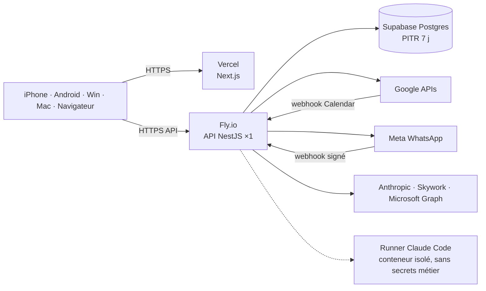

# 15. Plan de déploiement

## 15.1 Environnements

| Env. | Usage | Base | Front | API |
|---|---|---|---|---|
| **local** | Développement | Docker `postgres:16` (`pnpm db:up`) | `localhost:3000` | `localhost:4000` (`ALLOW_DEV_LOGIN=true`) |
| **staging** | Recette avant mise en production | Projet Supabase « kairos-staging » | Vercel Preview | Fly.io app `kairos-api-staging` |
| **production** | Usage réel | Projet Supabase « kairos » (région Paris/Francfort, PITR) | Vercel (domaine perso) | Fly.io `kairos-api` (région `cdg`) |

Recommandation d'hébergement (usage personnel, coût faible, données en UE) : **Supabase** (PostgreSQL managé) + **Fly.io** ou **Railway** pour l'API (process long nécessaire aux crons) + **Vercel** pour le web. Alternative tout-en-un : un VPS (Scaleway/OVH) avec `docker compose --profile full up -d` derrière Caddy (TLS automatique).

## 15.2 Architecture de production

## 15.3 Étapes de mise en production (checklist)

1. **Supabase** : créer le projet (UE), récupérer l'URL de connexion *pooler* → `DATABASE_URL`. Activer PITR.
2. **Google Cloud** :
   - Créer un projet, activer *Google Calendar API*, *Gmail API*, *Google Drive API*.
   - Écran de consentement OAuth « Externe », statut **Test** avec votre adresse comme utilisateur de test (suffisant pour un usage personnel, évite l'audit de sécurité des portées Gmail restreintes).
   - Identifiants OAuth « Application Web » ; URI de redirection : `https://api.<domaine>/api/auth/google/callback`.
   - Renseigner `GOOGLE_CLIENT_ID`, `GOOGLE_CLIENT_SECRET`, `GOOGLE_REDIRECT_URI`.
3. **WhatsApp (Meta for Developers)** : application Business, numéro WhatsApp, jeton permanent (utilisateur système), modèle `kairos_reminder` (catégorie *Utility*, langue fr, corps « {{1}} ») soumis à validation ; webhook `https://api.<domaine>/api/webhooks/whatsapp` avec `WHATSAPP_VERIFY_TOKEN` ; `WHATSAPP_APP_SECRET` pour la signature.
4. **IA** : `ANTHROPIC_API_KEY` (+ `ANTHROPIC_MODEL`), et selon besoin Skywork, Entra ID (Copilot), runner Claude Code.
5. **Secrets** : `JWT_SECRET` (64 caractères aléatoires), `ENCRYPTION_KEY` (`openssl rand -base64 32`), `OWNER_EMAIL`. Stockés dans le coffre de l'hébergeur (`fly secrets set …`), jamais dans le dépôt.
6. **API** : `fly launch --dockerfile apps/api/Dockerfile` ; le conteneur applique `prisma migrate deploy` au démarrage puis lance l'API ; health check `/api/health`. **Une seule instance** (crons en mémoire) jusqu'au passage à BullMQ (V2).
7. **Web** : projet Vercel racine `apps/web`, variable `NEXT_PUBLIC_API_URL=https://api.<domaine>/api`. Cookies : API et web sur le même domaine parent (`app.` / `api.`) pour `SameSite=Lax`.
8. **Calendrier temps réel** : appeler `POST /api/calendar/watch` (le canal Google expire ~7 j : renouvellement automatique à ajouter au MVP sprint 2).
9. **Mobile** : `eas build -p ios|android` (profil *preview*), distribution TestFlight / test interne Play ; `EXPO_PUBLIC_API_URL`.
10. **Desktop** : `pnpm --filter @kairos/desktop build` sur une machine Windows et une machine macOS (ou GitHub Actions `tauri-action`), signature de code recommandée.

## 15.4 CI/CD

- **CI** (`.github/workflows/ci.yml`, à chaque PR) : installation figée, tests du moteur, migrations sur Postgres de service, typecheck/tests/build API, typecheck/build web, typecheck mobile.
- **CD** (à ajouter) : merge sur `main` → déploiement staging automatique ; tag `v*` → production (Fly + Vercel) ; migrations exécutées au démarrage du conteneur (compatibles avant/arrière : ajout de colonnes nullable d'abord).

## 15.5 Exploitation

| Sujet | Dispositif |
|---|---|
| Sauvegardes | PITR Supabase 7 j + export `pg_dump` hebdomadaire chiffré vers Drive (V2) |
| Supervision | Health check hébergeur, Sentry (API + web), alerte si `AiRun.success=false` > 20 % sur 1 h |
| Journaux | JSON structurés, sans contenu d'email ni jeton |
| Coûts | Supabase Free/Pro, Fly ~5 €/mois, Vercel Hobby, IA à l'usage (tri des emails à effort bas), WhatsApp : conversations *utility* facturées par Meta |
| Reprise | Restauration PITR + redéploiement de l'image ; les clients hors ligne resynchronisent automatiquement |
